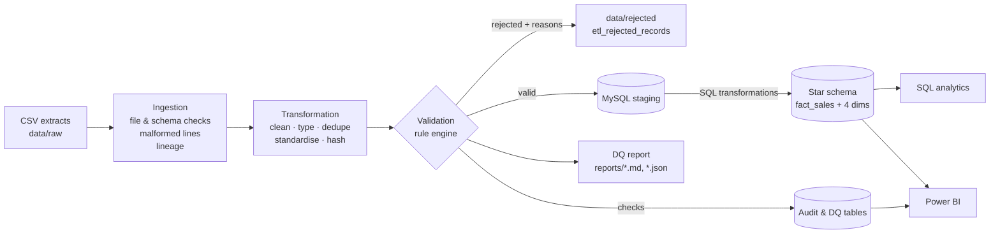
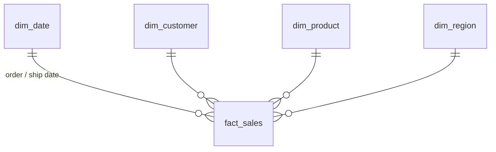

# Retail Sales Data Engineering Platform

An end-to-end, tested data engineering project. It ingests raw retail extracts, cleans and
validates them with a rule-based data quality framework, loads a **MySQL 8 star-schema data
warehouse** incrementally and idempotently, records full ETL audit metadata, and serves analytics
through a SQL query library and a Power BI dashboard design.

Built on the real, public **Tableau "Sample - Superstore"** dataset (9,994 US order lines,
2015-2018).

```
python scripts/download_dataset.py   # get the real data
python run_pipeline.py               # check -> extract -> transform -> validate -> load -> audit -> report
python run_analytics.py              # run the analytical SQL library
pytest                               # 71 automated tests (unit + MySQL integration)
```

---

## Contents
1. [Business problem](#business-problem)
2. [Architecture](#architecture)
3. [Technology stack](#technology-stack)
4. [Dataset](#dataset)
5. [Installation](#installation)
6. [Database configuration](#database-configuration)
7. [Running the pipeline](#running-the-pipeline)
8. [ETL workflow](#etl-workflow)
9. [Data warehouse schema](#data-warehouse-schema)
10. [Data quality](#data-quality)
11. [Analytics SQL](#analytics-sql)
12. [Testing](#testing)
13. [Power BI](#power-bi)
14. [Results on the real data](#results-on-the-real-data)
15. [Screenshots](#screenshots)
16. [Project structure](#project-structure)
17. [Future enhancements](#future-enhancements)

---

## Business problem

A retailer receives order, return and regional-manager extracts as CSV files. Analysts reported
inconsistent numbers because the files were combined by hand in spreadsheets: duplicate lines
counted twice, ZIP codes losing leading zeros, no record of what was loaded or when, and no way to
tell whether a figure included the latest extract.

This platform provides:

* **One trusted source of truth**: a dimensional warehouse with enforced keys and constraints.
* **Automated, repeatable loads**: one command, safe to rerun, loads only new or changed data.
* **Measurable data quality**: every rejected record is kept with its reason, and every run
  produces a data quality report and is audited.
* **Self-service analytics**: reusable SQL for the core KPIs and a Power BI model design covering
  sales, products, customers, regions and pipeline health.

## Architecture



* **Hybrid ETL/ELT:** Python does the file handling, parsing and row-level validation; set-based
  dimensional loading happens in version-controlled SQL inside MySQL.
* **Atomic loads:** staging, dimensions, fact and file registration commit in one transaction;
  a failure leaves the warehouse untouched.
* **Two-level idempotency:** file checksums skip files that were already loaded; a unique source key
  plus row hashes make row-level reloads insert or update nothing that has not changed.

Full details and the reasoning behind each decision: **[docs/architecture.md](docs/architecture.md)**.

## Technology stack

| Layer | Technology |
|---|---|
| Language | Python 3.10 – 3.13 (test suite passed on each) |
| Processing | pandas 2.2 – 3.x (tested: 2.2.3, 2.3.3, 3.0.5, 3.1.1) |
| Database | MySQL 8.0 (tested on 8.0.46), InnoDB |
| DB access | SQLAlchemy 2.x + PyMySQL (pure Python, no compiler needed) |
| SQL | DDL, CTEs (incl. recursive), window functions, upserts |
| Testing | pytest (unit + integration against a real MySQL test database) |
| BI | Power BI Desktop (design and DAX documented) |
| Version control | Git |

No Docker, Spark, Airflow or cloud services: everything runs on an 8 GB laptop. A full load uses
about 160 MB of RAM and takes about 5 seconds (measured, see the architecture doc).

## Dataset

**Tableau "Sample - Superstore"**, a widely used public retail dataset, downloaded from the
mirror at `github.com/leonism/sample-superstore` (`data/superstore.csv`) by
`scripts/download_dataset.py`.

That file is an export of the original Excel workbook with its three sheets stacked one after
another. The script verifies the SHA-256, splits it into three source files and writes them to
`data/raw/`:

| File | Rows | Content |
|---|---:|---|
| `superstore_orders.csv` | 9,994 | Order lines: order/ship dates, customer, segment, location, region, product, category, sales, quantity, discount, profit |
| `superstore_returns.csv` | 800 | Returned orders (one row per returned line) |
| `superstore_people.csv` | 4 | Regional manager for each region |

The raw data is **not committed** (it is downloaded on demand). A separate, clearly labelled
**synthetic** demo increment can be generated to show incremental loads and rejections (see
[Data quality](#data-quality)). It never overwrites the real files.

## Installation

Prerequisites: Python 3.10 or newer (tested on 3.10, 3.11, 3.12, 3.13), MySQL Server 8.0, Git.

```bash
git clone <your-repo-url> retail-data-platform
```

```bash
cd retail-data-platform
```

Create and activate a virtual environment (Linux/macOS):

```bash
python3 -m venv .venv && source .venv/bin/activate
```

On Windows (PowerShell), use these two commands instead:

```bash
python -m venv .venv
```

```bash
.venv\Scripts\Activate.ps1
```

Install the dependencies:

```bash
pip install -r requirements.txt
```

## Database configuration

1. Install MySQL 8.0 (Windows: MySQL Installer; Ubuntu: `sudo apt install mysql-server`;
   macOS: `brew install mysql`) and make sure the server is running.
2. As a MySQL admin (`mysql -u root -p`), create a dedicated ETL account. Use your own password:

```sql
CREATE USER 'etl_user'@'localhost' IDENTIFIED BY '<choose-a-strong-password>';
GRANT ALL PRIVILEGES ON retail_dw.*      TO 'etl_user'@'localhost';
GRANT ALL PRIVILEGES ON retail_dw_test.* TO 'etl_user'@'localhost';
```

   If you connect via `127.0.0.1` rather than `localhost`, create the same user for
   `'etl_user'@'127.0.0.1'` too.

3. Configure credentials locally (the `.env` file is git-ignored):

```bash
cp .env.example .env
```

   Then edit `.env` and set `DB_PASSWORD`, and `DB_HOST`/`DB_PORT` if they differ.

4. Create the database and deploy the schema (the pipeline also does this automatically):

```bash
python scripts/setup_database.py
```

## Running the pipeline

Download the real dataset (once):

```bash
python scripts/download_dataset.py
```

Run the pipeline. This is the single entry point, and it is safe to run as often as you like:

```bash
python run_pipeline.py
```

| Option | Effect |
|---|---|
| *(none)* | Incremental run: files whose exact content was already loaded are skipped |
| `--force` | Reprocess every file. Unchanged rows are detected by hash, so nothing is duplicated |
| `--dry-run` | Ingest, transform, validate and write reports **without** a database |
| `--raw-dir PATH` | Read source files from another folder |

Run the analytical SQL library (results go to `reports/analytics/*.csv`):

```bash
python run_analytics.py
```

Optional: generate and load the synthetic demo increment (this adds synthetic 2019 rows):

```bash
python scripts/generate_demo_increment.py
```

```bash
python run_pipeline.py --raw-dir data/demo_increment
```

Reset the warehouse to an empty state (destroys all data):

```bash
python scripts/setup_database.py --reset --yes
```

The exit code is `0` on success (including `NO_NEW_DATA`), `1` if the run failed and `2` if the
database is unreachable, so the pipeline can be scheduled with cron or Windows Task Scheduler.

### Outputs of every run

| Output | Location |
|---|---|
| Data quality & execution report | `reports/run_NNNNNN_dq_report.md` and `.json` |
| Rejected records (raw values + reasons + line numbers) | `data/rejected/run_NNNNNN_<source>_rejected.csv`, table `etl_rejected_records` |
| Clean, validated data | `data/processed/run_NNNNNN_<source>_clean.csv` |
| Run audit | tables `etl_pipeline_runs`, `etl_file_registry`, `etl_data_quality_results` |
| Logs | `logs/pipeline.log` (rotating) and the console |

## ETL workflow

1. **Check source files**: required `orders` missing means the run fails cleanly; optional
   `returns`/`people` missing means a warning and the run continues.
2. **Extract** (`src/ingestion`): detect encoding (UTF-8/CP1252), validate the header against the
   source contract (case/spacing insensitive), stream rows in chunks, capture malformed lines with
   their line numbers, and attach `_source_file`, `_source_line`, `_ingested_at`. Compute a SHA-256
   and skip files already loaded.
3. **Transform** (`src/transformation`): trim whitespace, remove exact duplicates, convert types
   (recording unparseable values), standardise six date formats to ISO, normalise case, restore ZIP
   leading zeros, impute missing postal codes from the same city/state, default missing discount to
   0, derive `ship_days` and `unit_price`, and compute `row_hash` and `business_hash`.
4. **Validate** (`src/validation`): about 20 rules per run covering null checks, data types,
   invalid dates, negative quantities, invalid financial values, primary-key uniqueness, duplicate
   transactions (in-batch and against the warehouse), referential integrity (regions, returns
   against orders), plus row-count reconciliation.
5. **Load** (`src/loading` + `sql/transformations`), in **one transaction**: stage, then upsert the
   dimensions (SCD1), load the fact incrementally (update changed rows, insert new ones), apply
   returns, and register the files.
6. **Audit**: run row (start/end, counts, status, error), DQ results, rejected records.
7. **Report**: Markdown and JSON data quality report.
8. **Errors**: logged with context; the run is marked `FAILED` and the transaction is rolled back.

## Data warehouse schema



| Table | Rows (real data) | Grain / key |
|---|---:|---|
| `fact_sales` | 9,993 | One order line; `UNIQUE(order_id, source_row_id)` |
| `dim_customer` | 793 | Customer; natural key `customer_id` |
| `dim_product` | 1,894 | Product; natural key `(product_id, product_name)` because the source reuses IDs |
| `dim_region` | 632 | Ship-to location rolling up to region and manager |
| `dim_date` | 1,826 | Calendar day 2015-2019, key `YYYYMMDD`, role-playing (order/ship) |

Plus staging tables (`stg_*`), audit tables (`etl_*`) and reporting views (`vw_*`). Foreign keys,
indexes on every fact foreign key, and `CHECK` constraints (`quantity > 0`, `sales > 0`,
`0 <= discount < 1`, `profit <= sales`) are enforced by the database.

> The requirement names FactSales / DimCustomer / DimProduct / DimDate / DimRegion are implemented
> as snake_case tables. MySQL on Windows lower-cases table names, so mixed case is not portable.

Full column dictionary and load logic: **[docs/data_warehouse_schema.md](docs/data_warehouse_schema.md)**.

## Data quality

Each rule has a severity: `ERROR` rejects the record, `WARNING` keeps it but flags it. Rejected
records keep their **original raw values**, source line and every failed rule.

Example from the real data (`docs/sample_outputs/run_000001_orders_rejected.csv`): Row ID 3407 is
the same transaction as Row ID 3406 under a different row id, so it is rejected as
`DUPLICATE_TRANSACTION`.

The full rule catalogue and the results are in **[docs/data_quality.md](docs/data_quality.md)**.
The complete report of the initial load is in
[docs/sample_outputs/run_000001_dq_report.md](docs/sample_outputs/run_000001_dq_report.md).

Loading the synthetic demo increment on top of the real data gave these results: 200 lines inserted,
1 corrected line updated, 1 re-sent line unchanged, 1 malformed line caught, 1 exact duplicate
removed, 11 records rejected (one per planted defect plus a duplicate transaction) and 1 orphan
return rejected. Every source reconciled.

## Analytics SQL

`sql/analytics/` holds 11 reusable queries: KPI overview (revenue, profit, margin, AOV, return
rate), monthly trend with MoM growth, moving average and YTD, year-over-year growth, top products,
category performance, RFM customer segmentation, regional performance, repeat customers, average
order value, returns and discount impact. They use joins, CTEs (including recursive), subqueries and
window functions (`LAG`, `RANK`, `DENSE_RANK`, `ROW_NUMBER`, `NTILE`, framed `AVG`/`SUM`).

Results from the real data are in [docs/sample_outputs/analytics/](docs/sample_outputs/analytics/).

## Testing

```bash
pytest
```

| Test module | Covers |
|---|---|
| `test_ingestion.py` | file checks, empty/missing files, header contract, malformed lines and line numbers, quoted commas, encodings, chunking |
| `test_transformation.py` | each cleaner, date formats, numeric parsing, ZIP codes, imputation, duplicate removal, hashing, source transformers |
| `test_validation.py` | every rule, multiple reasons, survivor-only uniqueness, cross-load duplicates, warnings, report output |
| `test_pipeline.py` | end-to-end dry runs, reconciliation, rejected-file contents, missing required/optional files, schema errors |
| `test_database.py` | schema idempotency, star-schema load, audit tables, rerun skip, forced idempotent rerun, incremental insert + update + SCD1, duplicate prevention by unique key, CHECK constraints, **rollback on failure**, every analytics query |

**Latest result: 71 passed** against MySQL 8.0.46 on every tested combination:

| Python | pandas | Result |
|---|---|---|
| 3.10.20 | 2.3.3 | 71 passed |
| 3.11.18 | 3.1.1 | 71 passed |
| 3.12.3 | 3.1.1 | 71 passed |
| 3.13.18 | 3.0.5 | 71 passed |
| 3.13.18 | 2.2.3 | 71 passed (FutureWarnings treated as errors) |

The database tests use the separate `DB_TEST_NAME` database (it must end in `_test`), which is
dropped and recreated for each test. If MySQL is not reachable they are **skipped**, so the unit
tests still run anywhere. To run only the unit tests:

```bash
pytest -m "not db"
```

## Power BI

Power BI Desktop runs only on Windows and was not available in the build environment, so **no
.pbix file is included**. **[docs/powerbi_guide.md](docs/powerbi_guide.md)** gives exact manual
steps:

* connecting with a read-only MySQL account (MySQL Connector/NET), Import mode;
* Power Query clean-up, relationships (role-playing date with `USERELATIONSHIP`), date table,
  hierarchies;
* about 40 DAX measures (core KPIs, time intelligence, repeat customers, returns, ranking,
  pipeline monitoring);
* a six-page layout: **Executive Overview, Sales Performance, Product Analysis, Customer Analysis,
  Regional Analysis, Data Quality & Pipeline Monitoring**, with slicers and KPIs for each page;
* a table of expected values to check the model against SQL.

## Results on the real data

From the initial load (run 1) and `run_analytics.py`:

| KPI | Value |
|---|---:|
| Total revenue | $2,296,919.49 |
| Total profit | $286,409.08 |
| Profit margin | 12.47% |
| Orders / customers | 5,009 / 793 |
| Average order value | $458.56 |
| Order return rate | 5.91% |
| Revenue growth 2017 / 2018 | +29.47% / +20.36% |

Insights the SQL surfaces:

* **Discounts drive losses**: lines discounted above 20% have negative margins (-15.3% at 21-40%,
  -77.4% above 40%), while undiscounted lines earn a 29.5% margin.
* **Tables, Bookcases and Supplies lose money** despite strong revenue.
* **Central** is the weakest region by margin (7.9% vs 14.9% for West).
* **98.5% of customers are repeat buyers**; customers with 5-9 orders generate 68.5% of revenue.

The warehouse totals were checked against an independent pandas calculation on the raw file, and
they match to the cent.

## Screenshots

> Add screenshots here after building the Power BI report locally (save them to
> `docs/screenshots/`). They are not included because the report has to be built in Power BI
> Desktop on Windows.

| Page | Screenshot |
|---|---|
| Executive Overview | `docs/screenshots/01_executive_overview.png` *(to add)* |
| Sales Performance | `docs/screenshots/02_sales_performance.png` *(to add)* |
| Product Analysis | `docs/screenshots/03_product_analysis.png` *(to add)* |
| Customer Analysis | `docs/screenshots/04_customer_analysis.png` *(to add)* |
| Regional Analysis | `docs/screenshots/05_regional_analysis.png` *(to add)* |
| Data Quality & Pipeline Monitoring | `docs/screenshots/06_data_quality.png` *(to add)* |

## Project structure

```
retail-data-platform/
├── run_pipeline.py              # single pipeline entry point
├── run_analytics.py             # runs the SQL analytics library
├── requirements.txt / .env.example / .gitignore / pytest.ini
├── data/
│   ├── raw/                     # source CSVs (downloaded, not committed)
│   ├── processed/               # clean validated output per run
│   └── rejected/                # rejected records + reasons per run
├── src/
│   ├── config.py                # paths, env-based DB config, source contracts
│   ├── pipeline.py              # orchestrator
│   ├── ingestion/               # CSVIngestor
│   ├── transformation/          # cleaners + per-source transformers
│   ├── validation/              # rules, validator, DQ report
│   ├── loading/                 # warehouse loader + audit repository
│   ├── analytics/               # SQL library runner
│   └── utils/                   # logging, DB helpers, file helpers
├── sql/
│   ├── schema/                  # DDL: staging, dimensions, fact, audit, views
│   ├── transformations/         # staging -> star schema load SQL
│   └── analytics/               # 11 analytical queries
├── scripts/
│   ├── download_dataset.py      # fetch + split the public dataset
│   ├── setup_database.py        # create DB + deploy schema (--reset, --test)
│   └── generate_demo_increment.py  # SYNTHETIC incremental batch with planted defects
├── tests/                       # 71 pytest tests
├── docs/                        # architecture, schema, data quality, Power BI, sample outputs
├── logs/                        # pipeline.log (generated)
└── reports/                     # DQ reports + analytics CSVs (generated)
```

## Future enhancements

* **SCD Type 2** for customer segment and product category history (`valid_from`/`valid_to`).
* **Orchestration** with Apache Airflow or Dagster (each pipeline step is already a separate,
  testable method), plus alerting on `FAILED` runs.
* **Parquet** for processed and rejected outputs (smaller and typed), and partitioned staging for
  very large files.
* **Concurrency guard**: a run lock (`GET_LOCK`) so two schedulers cannot load at the same time.
* **Data contracts in YAML** so rules and source schemas can be changed without code changes.
* **CI**: GitHub Actions running the tests against a MySQL service container on every push.
* **Power BI**: publish to the service with an on-premises gateway and scheduled refresh; commit a
  `.pbit` template.
* **dbt** for the SQL transformation layer (tests, docs and lineage graphs).
