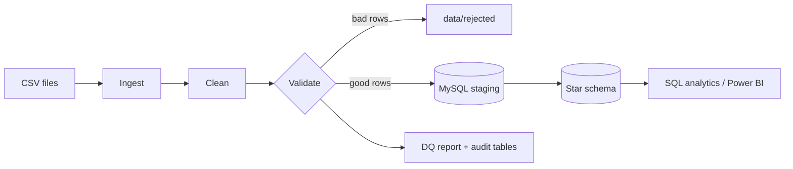

# Retail Data Platform

An end-to-end ETL project I built to practise data engineering properly: take raw retail CSV
files, clean and validate them, load them into a MySQL star schema, and report on them with SQL and
Power BI.

It uses the public Tableau "Sample - Superstore" dataset (9,994 US order lines, 2015-2018).

## What it does

- Reads the raw order, return and regional-manager files and checks they look right (file exists,
  expected columns, no broken lines).
- Cleans the data: types, dates in different formats, duplicates, missing values, ZIP codes that
  lost their leading zero, and so on.
- Runs data quality checks. Bad rows are not loaded; they go to a "rejected" file with the reason
  next to each one.
- Loads a MySQL warehouse (one fact table, four dimensions). Loads are incremental, so running it
  twice doesn't duplicate anything.
- Records every run in audit tables (start/end time, row counts, status, errors) and writes a data
  quality report.
- Includes a set of analysis queries and a plan for a 6-page Power BI dashboard.

## Quick start

You need Python 3.10+ and MySQL 8.0.

```bash
pip install -r requirements.txt
```

```bash
cp .env.example .env
```

Put your MySQL user and password in `.env`, then:

```bash
python scripts/download_dataset.py
```

```bash
python run_pipeline.py
```

```bash
python run_analytics.py
```

```bash
pytest
```

## Setup in a bit more detail

**Python environment** (optional but recommended):

```bash
python -m venv .venv
```

Activate it with `source .venv/bin/activate` on Linux/macOS or `.venv\Scripts\Activate.ps1` on
Windows, then install `requirements.txt`.

**MySQL user.** Log in as root and create a user for the pipeline (pick your own password):

```sql
CREATE USER 'etl_user'@'localhost' IDENTIFIED BY 'your_password';
GRANT ALL PRIVILEGES ON retail_dw.*      TO 'etl_user'@'localhost';
GRANT ALL PRIVILEGES ON retail_dw_test.* TO 'etl_user'@'localhost';
```

If you connect with `127.0.0.1` instead of `localhost`, create the user for `'etl_user'@'127.0.0.1'`
as well. The `retail_dw_test` database is only used by the tests.

**Database.** The pipeline creates the database and tables itself on the first run. You can also
do it up front:

```bash
python scripts/setup_database.py
```

`.env` is in `.gitignore`, so your password never ends up in git.

## The data

`scripts/download_dataset.py` downloads the Superstore CSV from
[leonism/sample-superstore](https://github.com/leonism/sample-superstore). That file is the Excel
workbook exported with all three sheets stacked on top of each other, so the script splits it into
three files in `data/raw/`:

- `superstore_orders.csv`: 9,994 order lines
- `superstore_returns.csv`: 800 returned order lines
- `superstore_people.csv`: the manager for each of the 4 regions

I don't commit the data itself; the script fetches it.

## How the pipeline works



`run_pipeline.py` runs these steps in order:

1. **Ingest** (`src/ingestion`): check each file exists and has the right columns, read it in
   chunks, and set aside any line with the wrong number of fields (with its line number). Each row
   gets tagged with its source file, line number and load time.
2. **Clean** (`src/transformation`): convert types, accept a handful of date formats, drop exact
   duplicates, fill in missing values where it's safe to, fix ZIP codes, and add a hash of each row
   so changed rows can be detected later.
3. **Validate** (`src/validation`): nulls, bad dates, negative quantities, impossible amounts
   (like profit bigger than sales), duplicate keys, the same transaction sent twice, unknown
   regions, and returns for orders that don't exist. Then check the counts add up:
   rows read = rows rejected + rows kept.
4. **Load** (`src/loading` + `sql/transformations`): put the good rows in staging tables, then let
   SQL build the dimensions and merge into the fact table. All of this runs in one transaction, so
   if something breaks halfway the warehouse is left exactly as it was.
5. **Audit and report**: save the run details to the `etl_*` tables and write
   `reports/run_NNNNNN_dq_report.md` (and a `.json` copy).

### Running it again

Each loaded file's checksum is stored, so running the pipeline again with the same files does
nothing (the run status is `NO_NEW_DATA`). `--force` reprocesses everything anyway. Even then,
the fact table has a unique key on the source row, and rows are compared by hash, so unchanged rows
are left alone and nothing gets duplicated. Changed rows are updated.

Other options:

```bash
python run_pipeline.py --dry-run          # no database, just clean + validate + report
```

```bash
python run_pipeline.py --raw-dir some/folder
```

To start over with an empty warehouse:

```bash
python scripts/setup_database.py --reset --yes
```

## The warehouse

Star schema in MySQL:

- `fact_sales`: one row per order line (9,993 rows)
- `dim_customer`: 793 customers
- `dim_product`: 1,894 products
- `dim_region`: 632 ship-to locations, rolling up to the 4 regions and their managers
- `dim_date`: one row per day, used for both order date and ship date

There are also staging tables (`stg_*`), audit tables (`etl_*`) and a few views for reporting
(`vw_*`). Foreign keys and CHECK constraints are enforced in the database too, so even if something
slipped past the Python checks MySQL would refuse it.

A few things I had to work around:

- Some product IDs in the source are used for two different products, so the product dimension
  is keyed on ID + name.
- Customers ship to several different places, so location lives in its own dimension instead of on
  the customer.
- I used snake_case names (`fact_sales` rather than `FactSales`) because MySQL on Windows lowercases
  table names and that breaks mixed-case names.

More detail: [docs/data_warehouse_schema.md](docs/data_warehouse_schema.md) and
[docs/architecture.md](docs/architecture.md).

## Data quality

The real file is pretty clean. On the first load:

- 1 row rejected: Row ID 3407 is the same transaction as Row ID 3406, just with a different row id.
- 11 rows have no postal code (all Burlington, Vermont), so they're stored as `UNKNOWN` with a
  warning.
- 337 rows use a product ID that's shared with a differently named product (warning only).
- 349 rows lose more money than the sale was worth, usually because of big discounts (warning only).

Because there's so little bad data, I also wrote `scripts/generate_demo_increment.py`. It makes a
small **fake** batch with one deliberately broken row per rule, written to `data/demo_increment/`
so the real files aren't touched. Loading that on top of the real data gave 200 new rows inserted,
1 corrected row updated, 1 unchanged, 11 rejected, 1 broken CSV line caught, 1 exact duplicate
dropped and 1 orphan return rejected. (Reset the database afterwards if you only want real data.)

The full list of rules is in [docs/data_quality.md](docs/data_quality.md), and the report from the
real run is in [docs/sample_outputs/](docs/sample_outputs/).

## Analysis queries

`sql/analytics/` has 11 queries: overall KPIs, monthly trend, year-over-year growth, top products,
category performance, RFM customer segments, regional performance, repeat customers, average order
value, returns and discount impact. `python run_analytics.py` runs them all and saves CSVs to
`reports/analytics/`.

Some numbers from the real data:

- Revenue $2,296,919.49, profit $286,409.08 (12.47% margin)
- 5,009 orders from 793 customers, average order $458.56
- Revenue grew 29.5% in 2017 and 20.4% in 2018
- Discounts over 20% lose money on average; undiscounted sales make about 29.5%
- Tables, Bookcases and Supplies lose money overall
- Central has the lowest margin of the four regions (7.9%, vs 14.9% for West)

I checked the warehouse totals against a separate pandas calculation on the raw CSV, and they
match.

## Power BI

I built this on Linux, where Power BI Desktop doesn't run, so there's no `.pbix` file in the repo.
[docs/powerbi_guide.md](docs/powerbi_guide.md) has the steps to build it: connecting to MySQL, the
data model, the DAX measures, and what goes on each of the six pages (Executive Overview, Sales,
Products, Customers, Regions, and Data Quality / Pipeline Monitoring).

## Tests

```bash
pytest
```

There are 71 tests covering ingestion, cleaning, every validation rule, the pipeline in dry-run
mode, and database tests for incremental loads, reruns, duplicate prevention, constraints and
rollback when a load fails. All 71 pass on Python 3.10 to 3.13 with MySQL 8.0.46.

The database tests use the `retail_dw_test` database and recreate it for each test. If MySQL isn't
running they're skipped. To run only the non-database tests:

```bash
pytest -m "not db"
```

## Project layout

```
run_pipeline.py        run the ETL
run_analytics.py       run the analysis queries
src/
  ingestion/           reading files
  transformation/      cleaning
  validation/          DQ rules and reports
  loading/             MySQL loading and audit tables
  analytics/           runs the SQL in sql/analytics
  utils/               logging, DB helpers
  pipeline.py          ties it all together
sql/
  schema/              table and view definitions
  transformations/     staging -> star schema
  analytics/           analysis queries
scripts/               download data, set up DB, make the fake demo batch
tests/
docs/
data/raw, processed, rejected
logs/, reports/        generated on each run
```

## Screenshots

Power BI screenshots will go in `docs/screenshots/` once I've built the report.

## Things I'd add next

- Keep history of customer/product changes (SCD type 2) instead of overwriting.
- Schedule it with Airflow, or just cron to start with, and send an alert when a run fails.
- A lock so two runs can't load at the same time.
- Run the tests in GitHub Actions on every push.
- Write processed files as Parquet instead of CSV.
- Publish the Power BI report with scheduled refresh.
