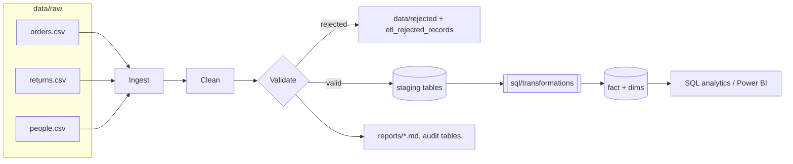

# Architecture notes

This is how the pipeline fits together and why I made some of the choices I did.

## Overview



`run_pipeline.py` creates a `RetailPipeline` (in `src/pipeline.py`) and calls `run()`. That:

1. makes sure the tables exist and inserts a row in `etl_pipeline_runs` with status `RUNNING`
2. reads each source file, skipping any file whose checksum was already loaded
3. cleans each source
4. validates it, writes rejected rows to a CSV and clean rows to `data/processed`
5. loads the warehouse in one transaction
6. saves DQ results, rejected rows and final counts to the audit tables
7. writes the report to `reports/`

Sources are handled in a fixed order: people, then orders, then returns. Orders are checked against
the regions in the people file, and returns are checked against the orders.

## Python vs SQL

Python does the file handling, cleaning and row-by-row checks, because that's where you want clear
error messages for each bad row. Once the data is clean, the dimensional loading is done in SQL
inside MySQL (`sql/transformations/`): assigning surrogate keys, upserting dimensions and merging
into the fact table. That's set-based work that the database is good at, it runs inside a
transaction, and anyone can read the SQL files to see exactly how the warehouse is built.

## Some decisions

**Read everything as text first.** The ingestion step doesn't convert any types. The cleaning step
does, and when a value can't be converted it records why (for example `sales:invalid_number`)
instead of quietly turning it into NaN. That's also why the rejected files show the original raw
values: that's what someone needs to go and fix the source.

**Using the `csv` module instead of `pandas.read_csv` to read files.** pandas can skip bad lines,
but it doesn't tell you which line numbers they were, and it pads short lines with NaN without
complaining. Reading with `csv.reader` lets me catch every line with the wrong number of fields,
along with its line number. It also reads in chunks (`INGEST_CHUNK_SIZE`).

**Uniqueness rules run last.** Validation runs the row-level rules first, then the uniqueness
rules (duplicate key, duplicate transaction) only on rows that are still valid. Otherwise, if the
first copy of a row was bad and the second copy was fine, the second would be rejected as a
"duplicate" and both would be lost.

**Two kinds of rerun protection.**
- File level: `etl_file_registry` stores each loaded file's SHA-256, so the same file is skipped
  next time. `--force` overrides this.
- Row level: `fact_sales` has a unique key on `(order_id, source_row_id)`, and every row has a
  `row_hash`. On load, rows with a changed hash are updated, new keys are inserted, and everything
  else is left alone. Loading the same data twice inserts 0 rows and updates 0 rows.

There's also a `business_hash`, which leaves out the row id. It catches the same transaction being
sent again under a new row id, whether that happens within one file or across loads.

**One transaction for the load.** Staging, dimensions, the fact table, returns and the
file-registry entry are all committed together. If anything fails, it all rolls back, and the file
isn't marked as loaded, so the next run tries it again. Two MySQL gotchas came up here:
`TRUNCATE` and `ALTER TABLE` both commit implicitly. So staging is cleared with `DELETE`, and the
temp table used in the fact load declares its primary key in the `CREATE` statement.

The run row in `etl_pipeline_runs` is updated on a separate connection, so a `FAILED` status still
gets saved after the rollback.

**Constraints in the database as well.** The Python rules should catch bad data, but the tables
also have foreign keys, unique keys and CHECK constraints (`quantity > 0`, `sales > 0`, discount
between 0 and 1, `profit <= sales`) as a backstop.

**snake_case table names.** MySQL on Windows lowercases table names by default and Linux doesn't,
so `FactSales` would break if the database moved between the two. Hence `fact_sales`,
`dim_customer` and so on.

## Performance

I kept it small on purpose, with no Spark, Docker or cloud services. Measured on my dev machine
(4 vCPU, local MySQL 8.0.46) with the full dataset:

- full run including the MySQL load: about 4.8 s
- dry run without the database: about 0.85 s
- peak memory of the Python process: 158 MB, of which about 79 MB is just importing pandas and
  SQLAlchemy

Most of the time goes on inserting into staging. For much bigger files you'd lower
`INGEST_CHUNK_SIZE`; the main remaining cost is one pandas copy of the batch.

## Code layout

```
src/
  config.py               paths, DB settings from .env, expected columns per file
  pipeline.py             RetailPipeline
  ingestion/ingestor.py   CSVIngestor
  transformation/
    cleaners.py           small reusable cleaning functions
    transformer.py        one transformer per source
  validation/
    rules.py              the rules
    validator.py          runs rules, splits valid/rejected
    report.py             markdown + json report
  loading/
    loader.py             schema, staging, SQL loads, post-load checks
    audit.py              run / file / DQ / rejected-row tables
  analytics/runner.py     runs sql/analytics/*.sql
  utils/                  logging, DB engine, SQL file runner, file helpers
```

## Run statuses

- `RUNNING`: still going, or the process was killed
- `SUCCESS`: loaded and every check passed
- `SUCCESS_WITH_WARNINGS`: loaded, but some rows were rejected or flagged
- `NO_NEW_DATA`: nothing new to load
- `FAILED`: something broke and the load was rolled back (see `error_message` and `logs/pipeline.log`)

## Tracing a row back to its source

Each fact row has `etl_run_id`, which links to `etl_pipeline_runs` and from there to
`etl_file_registry` (file name and checksum). The staging tables also keep `source_file` and
`source_line`. Rejected rows keep the file, line number, raw values (as JSON) and reasons.
