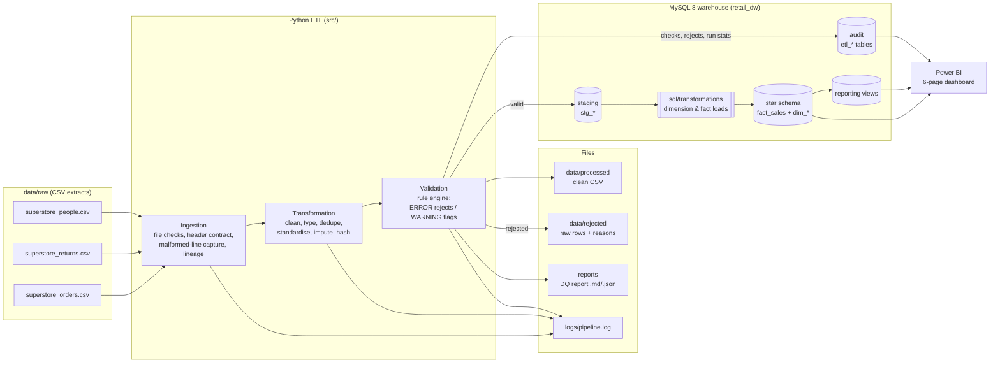

# Architecture

## 1. High-level flow



`run_pipeline.py` is the single entry point; `src/pipeline.py` (`RetailPipeline`) orchestrates the
steps in this order:

| # | Step | Module | Notes |
|---|------|--------|-------|
| 0 | Deploy schema, open audit run | `loading/loader.py`, `loading/audit.py` | DDL is idempotent; run row inserted with status `RUNNING` |
| 1 | Check source files | `ingestion/ingestor.py` | Required source missing => run `FAILED`; optional source missing => skipped with warning |
| 2 | Extract | `ingestion/ingestor.py` | Streams CSV in chunks; SHA-256 checksum; files already loaded are skipped |
| 3 | Transform | `transformation/` | Generic cleaners + one transformer per source |
| 4 | Validate | `validation/` | Rule engine, rejected records, row-count reconciliation |
| 5 | Load | `loading/loader.py` + `sql/transformations/*.sql` | One database transaction: staging -> dimensions -> fact -> returns -> file registry |
| 6 | Audit | `loading/audit.py` | Run status/counters, DQ results, rejected records |
| 7 | Report | `validation/report.py` | `reports/run_NNNNNN_dq_report.{md,json}` |
| 8 | Log errors | `utils/logger.py` | Console + rotating `logs/pipeline.log` |

## 2. Key architectural decisions

### Hybrid ETL + ELT
Python handles what Python is good at (file handling, parsing messy text, row-level rules with
precise rejection reasons). Once the data is clean and typed, set-based work - surrogate key
assignment, SCD upserts, the incremental fact merge - is done **in SQL inside MySQL**, where it is
transactional and visible to anyone reading `sql/transformations/`. This is how most production
warehouses split the work and it keeps each layer testable.

### Everything is read as text first
The ingestor never type-casts. Typing happens in the transformation layer, which records *why* a
value failed (`sales:invalid_number`, `order_date:invalid_date`) instead of silently coercing it.
Rejected-record files therefore contain the **original raw values**, which is what a data steward
needs to fix the source.

### Malformed-record detection with the `csv` module
`pandas.read_csv(on_bad_lines=...)` does not report line numbers and silently pads short rows with
NaN. The ingestor streams the file with Python's `csv` reader instead, so every row with the wrong
field count is captured with its exact line number, and memory use is bounded by
`INGEST_CHUNK_SIZE`.

### Rule engine with two passes
Rules are declarative (`name`, `category`, `severity`, `check`). Row-level rules run on all rows;
set-based rules (primary-key uniqueness, duplicate transactions) run only on rows that survived the
row-level ERROR rules. Without this, a bad first occurrence could cause a good second occurrence to
be rejected as a "duplicate", losing both.

### Two-level idempotency (safe reruns)
1. **File level** - `etl_file_registry` stores the SHA-256 of every successfully loaded file. An
   identical file is skipped (`NO_NEW_DATA`). `--force` bypasses this.
2. **Row level** - `fact_sales` has `UNIQUE (order_id, source_row_id)`. The fact load updates rows
   whose `row_hash` changed and inserts only unseen keys. Re-loading the same data inserts 0 and
   updates 0 rows (verified by `test_forced_rerun_is_idempotent`).

A second hash, `business_hash`, excludes the row id and catches the same transaction re-sent under
a new row id - both within a batch and against data already in the warehouse.

### Atomic loads
Staging, dimensions, fact, returns and the file-registry entry are written in **one transaction**.
If any step fails the warehouse is unchanged and the file is not registered, so the next run retries
it (verified by `test_failed_load_rolls_back_completely`). Two MySQL details matter here:
* staging is cleared with `DELETE`, not `TRUNCATE` (TRUNCATE is DDL and commits implicitly);
* the temporary key-resolution table declares its primary key inline, because `ALTER TABLE`
  would also commit implicitly.

The audit run row is written on separate connections so a `FAILED` status survives the rollback.

### Defence in depth
Bad data is stopped by the Python rules, but the warehouse also enforces foreign keys, unique keys
and `CHECK` constraints (`quantity > 0`, `sales > 0`, `0 <= discount < 1`, `profit <= sales`).

### snake_case table names
The requirement names (FactSales, DimCustomer, ...) are implemented as `fact_sales`,
`dim_customer`, `dim_product`, `dim_date`, `dim_region`. MySQL on Windows lower-cases table names by
default (`lower_case_table_names=1`) while Linux is case-sensitive, so mixed-case names break when a
database moves between the two - a real risk when Power BI users run MySQL on Windows.

### Lightweight by design (8 GB laptop)
No Spark, Airflow, Docker or cloud services. Dependencies: pandas, SQLAlchemy, PyMySQL (pure
Python, no compiler needed), cryptography, python-dotenv, pytest.

Measured on the development machine (4 vCPU, Linux, MySQL 8.0.46 local) for the full
9,994-line dataset:

| Measurement | Value |
|---|---|
| Full pipeline run incl. MySQL load | 4.8 s (`docs/sample_outputs/run_000001_dq_report.md`) |
| Dry run (no database) | 0.85 s |
| Peak memory (RSS) of the whole Python process, full run | 158 MB |
| ...of which importing pandas + SQLAlchemy alone | 79 MB |

Most of the load time is the multi-row `INSERT` into staging. For much larger files, lower
`INGEST_CHUNK_SIZE`; the remaining in-memory step is one pandas copy of the batch.

## 3. Module map

```
src/
├── config.py                 paths, DB config from env, source contracts (SourceSpec)
├── pipeline.py               RetailPipeline orchestrator
├── ingestion/ingestor.py     CSVIngestor, IngestionResult, ingestion exceptions
├── transformation/
│   ├── cleaners.py           pure, reusable column functions
│   └── transformer.py        Orders / Returns / People transformers
├── validation/
│   ├── rules.py              Rule, Severity, rule-set builders
│   ├── validator.py          DataValidator, CheckResult, ValidationResult
│   └── report.py             DataQualityReport (Markdown + JSON)
├── loading/
│   ├── loader.py             WarehouseLoader (schema, staging, SQL loads, integrity checks)
│   └── audit.py              AuditRepository (runs, file registry, DQ, rejects, lookups)
├── analytics/runner.py       executes sql/analytics/*.sql -> CSV
└── utils/                    logging, DB engine + SQL script runner, file helpers
```

## 4. Run statuses

| Status | Meaning |
|---|---|
| `RUNNING` | Run in progress (or the process was killed) |
| `SUCCESS` | Loaded, every check passed |
| `SUCCESS_WITH_WARNINGS` | Loaded; some records were rejected and/or flagged |
| `NO_NEW_DATA` | Every source file was already loaded (or optional and missing) |
| `FAILED` | Error; warehouse load rolled back; see `error_message` and the log |

## 5. Data lineage

Every fact row can be traced back to its source:
`fact_sales.etl_run_id` -> `etl_pipeline_runs` -> `etl_file_registry` (file name + checksum), and
staging keeps `source_file` + `source_line`. Every rejected record keeps its source file, line number,
raw values (JSON) and reasons in `etl_rejected_records` and `data/rejected/`.
