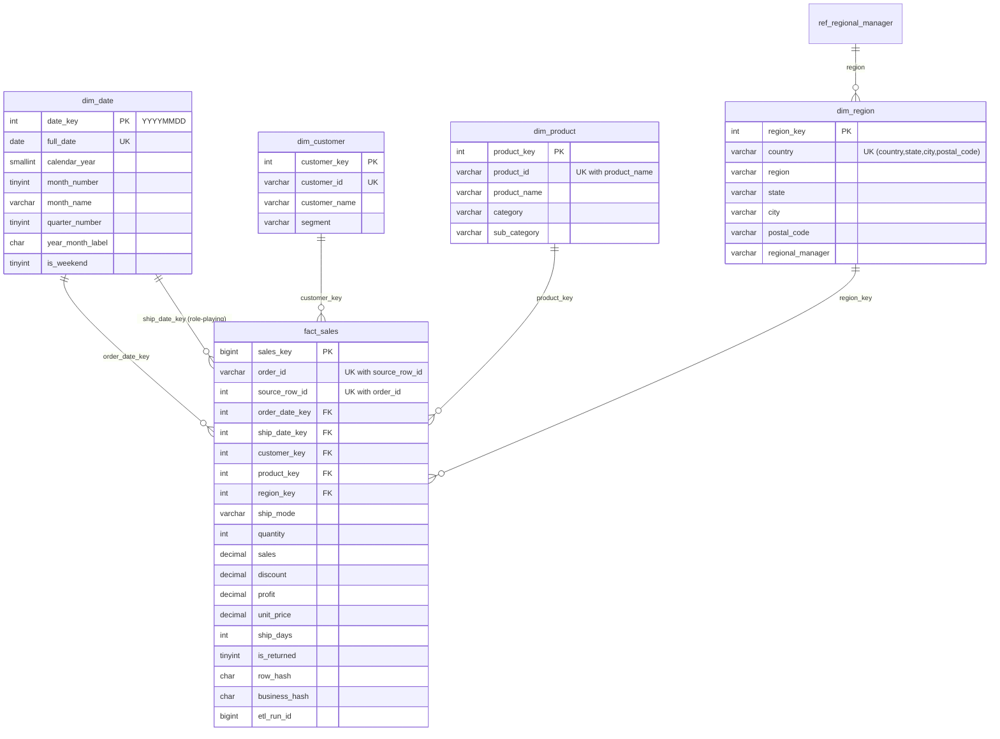

# Data Warehouse Schema (MySQL 8, database `retail_dw`)

DDL lives in `sql/schema/` and is applied in file order by `scripts/setup_database.py` (and
automatically, idempotently, at the start of every pipeline run).

| File | Contents |
|---|---|
| `01_staging_tables.sql` | `stg_orders`, `stg_returns`, `stg_people` |
| `02_dimension_tables.sql` | `ref_regional_manager`, `dim_date`, `dim_customer`, `dim_product`, `dim_region` |
| `03_fact_tables.sql` | `fact_sales` |
| `04_audit_tables.sql` | `etl_pipeline_runs`, `etl_file_registry`, `etl_data_quality_results`, `etl_rejected_records` |
| `05_reporting_views.sql` | `vw_sales_enriched`, `vw_pipeline_run_history`, `vw_dq_check_results`, `vw_rejection_summary` |

## Star schema



**Grain of `fact_sales`:** one order line (one product on one order), i.e. one row of the source
Orders extract.

### Design notes

* **Surrogate keys** (`*_key`, auto-increment) decouple the warehouse from source identifiers;
  natural keys are protected by `UNIQUE` constraints.
* **SCD Type 1** dimensions: attributes are overwritten with the latest value. When a key occurs
  several times in a batch, the most recent order wins (`ROW_NUMBER()` window in the load SQL).
  `etl_run_id` on a dimension row records the last run that actually *changed* it.
* **`dim_product` natural key = (`product_id`, `product_name`).** The source re-uses 32 Product IDs
  for different product names (detected by the `PRODUCT_ID_MULTIPLE_NAMES` warning: 337 order
  lines). Keying on the ID alone would silently attribute sales to the wrong product name.
* **`dim_region` grain = ship-to location** (country, state, city, postal code) rolling up to the
  four sales regions and their managers. Customers ship to several locations (766 of 793 customers
  appear in more than one region), so geography cannot live on `dim_customer`.
* **`dim_date`** is generated in SQL with a recursive CTE covering full calendar years of the data.
  It is role-playing: `order_date_key` (active in Power BI) and `ship_date_key` (inactive).
* **Degenerate dimensions** `order_id` and `ship_mode` stay on the fact table.
* **`is_returned`** comes from the Returns extract (order-level) and flags every line of a returned
  order.

## Table reference

### `fact_sales`

| Column | Type | Description |
|---|---|---|
| sales_key | BIGINT UNSIGNED PK | Surrogate key |
| order_id | VARCHAR(25) | Source order number (degenerate dimension) |
| source_row_id | INT | Source line identifier ("Row ID"); `UNIQUE(order_id, source_row_id)` |
| order_date_key / ship_date_key | INT FK -> dim_date | YYYYMMDD |
| customer_key / product_key / region_key | INT FK | Dimension keys |
| ship_mode | VARCHAR(30) | First / Second / Standard Class, Same Day |
| quantity | INT | Units, `CHECK (quantity > 0)` |
| sales | DECIMAL(12,4) | Net revenue after discount, `CHECK (sales > 0)` |
| discount | DECIMAL(5,4) | Discount rate, `CHECK (0 <= discount < 1)` |
| profit | DECIMAL(12,4) | Profit (can be negative), `CHECK (profit <= sales)` |
| unit_price | DECIMAL(12,4) | sales / quantity (derived) |
| ship_days | INT | ship_date - order_date (derived) |
| is_returned | TINYINT(1) | 1 if the order appears in Returns |
| row_hash | CHAR(64) | SHA-256 of all source fields - change detection |
| business_hash | CHAR(64) | SHA-256 excluding row id - duplicate-transaction detection |
| etl_run_id | BIGINT | Run that last inserted/updated the row |
| created_at / updated_at | TIMESTAMP | Housekeeping |

Indexes: PK, `uq_fact_sales_source`, one index per foreign key (`customer_key` composite with
`order_date_key` for customer-over-time queries), and `business_hash`.

### `dim_customer`
`customer_key` PK, `customer_id` UNIQUE, `customer_name`, `segment` (Consumer / Corporate /
Home Office), `etl_run_id`, timestamps. Index on `segment`.

### `dim_product`
`product_key` PK, `product_id`, `product_name` (`UNIQUE(product_id, product_name)`), `category`,
`sub_category`, `etl_run_id`, timestamps. Index on `(category, sub_category)`.

### `dim_region`
`region_key` PK, `country`, `region`, `state`, `city`, `postal_code`
(`UNIQUE(country, state, city, postal_code)`), `regional_manager`, `etl_run_id`, timestamps.
Postal codes are strings with leading zeros restored (`5401` -> `05401`); a missing code that
cannot be imputed is stored as `UNKNOWN` (11 Burlington, Vermont lines in the real data).

### `dim_date`
`date_key` (YYYYMMDD) PK, `full_date` UNIQUE, `day_of_month`, `day_name`, `day_of_week`
(1 = Monday), `day_of_year`, `week_of_year` (ISO), `month_number`, `month_name`, `month_short`,
`quarter_number`, `quarter_name`, `calendar_year`, `year_month_label` (YYYY-MM),
`year_quarter_label` (YYYY-Qn), `first_day_of_month`, `is_weekend`.
(`year_month` is a reserved word in MySQL, hence `year_month_label`.)

### `ref_regional_manager`
`region` PK, `regional_manager`. Persisted so that region managers are applied even in runs where
the People file is unchanged and skipped.

### Staging tables
`stg_orders`, `stg_returns`, `stg_people` hold the validated, typed rows of the current batch with
`etl_run_id`, `source_file`, `source_line` and `ingested_at`. They are cleared at the start of each
load (inside the load transaction) and keep the last batch for debugging.

## Audit tables

| Table | Grain | Key columns |
|---|---|---|
| `etl_pipeline_runs` | one row per run | `run_id`, `run_uuid`, `start_ts`, `end_ts`, `status`, `records_extracted`, `records_valid`, `records_rejected`, `records_loaded` (inserted), `records_updated`, `records_unchanged`, `checks_failed`, `checks_warning`, `triggered_by`, `error_message` |
| `etl_file_registry` | one row per distinct file content | `source_name`, `file_name`, `file_checksum` (`UNIQUE(source_name, file_checksum)`), size, counts, `run_id`, `processed_at` |
| `etl_data_quality_results` | one row per check per run | `run_id`, `source_name`, `check_name`, `check_category`, `severity`, `records_checked`, `records_failed`, `check_status` (PASS/WARN/FAIL) |
| `etl_rejected_records` | one row per rejected record | `run_id`, `source_name`, `source_file`, `source_line`, `rejection_reasons`, `raw_record` (JSON of original values) |

Example: inspect the raw values of rejected records

```sql
SELECT source_line, rejection_reasons,
       JSON_UNQUOTE(JSON_EXTRACT(raw_record, '$.order_id')) AS order_id,
       JSON_UNQUOTE(JSON_EXTRACT(raw_record, '$.sales'))    AS sales
FROM etl_rejected_records
WHERE run_id = (SELECT MAX(run_id) FROM etl_pipeline_runs);
```

## Load SQL (`sql/transformations/`, run in order inside one transaction)

| File | Technique |
|---|---|
| `01_load_ref_regional_manager.sql` | `INSERT ... SELECT ... ON DUPLICATE KEY UPDATE` |
| `02_load_dim_date.sql` | Recursive CTE calendar generator, `INSERT IGNORE` |
| `03_load_dim_customer.sql` | SCD1 upsert, `ROW_NUMBER()` to pick latest attributes |
| `04_load_dim_product.sql` | SCD1 upsert on composite natural key |
| `05_load_dim_region.sql` | SCD1 upsert + manager enrichment via `UPDATE ... JOIN` |
| `06_load_fact_sales.sql` | Key resolution into a temp table, hash-based `UPDATE`, anti-join `INSERT` |
| `07_apply_returns.sql` | `UPDATE ... JOIN` to flag returned orders |

The scripts read the session variable `@run_id`, set by the loader, so they only touch the current
batch.

## Reporting views

| View | Purpose |
|---|---|
| `vw_sales_enriched` | Flat, denormalised order lines with all dimension attributes (exports, ad-hoc SQL) |
| `vw_pipeline_run_history` | Runs with duration and rejection rate (Power BI monitoring page) |
| `vw_dq_check_results` | Every DQ check of every run with the run timestamp |
| `vw_rejection_summary` | Rejected record counts by run, source and reason |

## Analytical query library (`sql/analytics/`)

| File | Question answered | SQL features |
|---|---|---|
| `01_kpi_overview.sql` | Revenue, profit, margin, orders, customers, AOV, return rate | conditional aggregation |
| `02_monthly_sales_trend.sql` | Monthly trend, MoM growth, 3-month moving average, YTD | CTE, `LAG`, framed window, named `WINDOW` |
| `03_year_over_year_growth.sql` | YoY growth of revenue/profit/orders | CTE, `LAG` |
| `04_top_products.sql` | Top 10 products, profit rank, revenue share | CTE, `RANK`, `SUM() OVER ()` |
| `05_category_performance.sql` | Sub-category ranking inside each category, loss makers | `DENSE_RANK` partitioned, window over aggregate |
| `06_customer_segmentation_rfm.sql` | RFM customer segments | multiple CTEs, `NTILE`, scalar subquery, `CASE` |
| `07_regional_performance.sql` | Region scorecard with manager and top state | CTEs, `ROW_NUMBER`, `RANK` |
| `08_repeat_customers.sql` | Repeat-purchase bands and repeat rate | CTE, scalar subquery |
| `09_average_order_value.sql` | AOV by year and segment at order grain | CTE roll-up line -> order |
| `10_return_analysis.sql` | Return rate by category and region | `COUNT(DISTINCT CASE ...)` |
| `11_discount_impact.sql` | Margin by discount band | `CASE` banding, boolean averaging |

Run them all with `python run_analytics.py`; results land in `reports/analytics/*.csv`. The outputs
from the real dataset are committed in `docs/sample_outputs/analytics/`.
