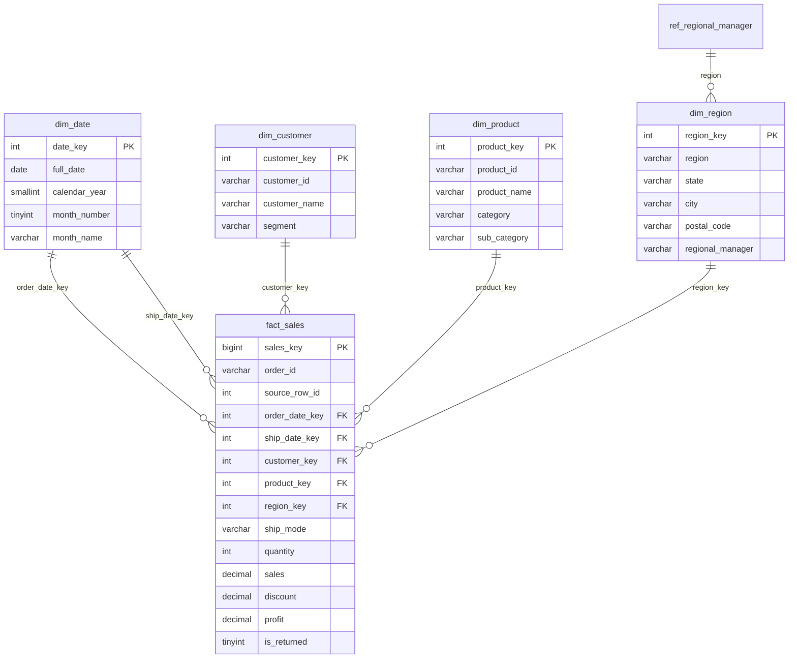

# Warehouse schema

Database: `retail_dw` (MySQL 8). The DDL is in `sql/schema/` and runs in file order. The pipeline
runs it at the start of every run too; it only creates things that don't exist yet.

- `01_staging_tables.sql`: `stg_orders`, `stg_returns`, `stg_people`
- `02_dimension_tables.sql`: `ref_regional_manager`, `dim_date`, `dim_customer`, `dim_product`, `dim_region`
- `03_fact_tables.sql`: `fact_sales`
- `04_audit_tables.sql`: `etl_pipeline_runs`, `etl_file_registry`, `etl_data_quality_results`, `etl_rejected_records`
- `05_reporting_views.sql`: `vw_sales_enriched`, `vw_pipeline_run_history`, `vw_dq_check_results`, `vw_rejection_summary`

## Star schema



`fact_sales` has one row per order line (one product on one order), the same grain as the source
Orders file.

### Why it's shaped like this

- Every dimension has an auto-increment surrogate key. The source IDs are kept with a unique
  constraint on them.
- Dimensions are SCD type 1: when an attribute changes, the old value is overwritten. If a customer
  appears more than once in a batch, the most recent order wins (`ROW_NUMBER()` in the load SQL).
- `dim_product` is unique on (product_id, product_name), not just product_id. The source uses 32
  product IDs for more than one product name (that's the `PRODUCT_ID_MULTIPLE_NAMES` warning on
  337 rows). Keying on the ID alone would have credited sales to the wrong product.
- `dim_region` is one row per ship-to location (country, state, city, postal code), rolling up to
  the 4 regions and their managers. Location can't go on the customer because 766 of the 793
  customers ordered to more than one region.
- `dim_date` is generated with a recursive CTE covering whole calendar years. The fact table uses
  it twice: once for the order date and once for the ship date.
- `order_id` and `ship_mode` just stay on the fact table. They don't need their own tables.
- `is_returned` comes from the returns file and is set on every line of a returned order.

## Tables

### fact_sales

| Column | Type | Notes |
|---|---|---|
| sales_key | BIGINT PK | surrogate key |
| order_id | VARCHAR(25) | from the source |
| source_row_id | INT | the source "Row ID"; (order_id, source_row_id) is unique |
| order_date_key, ship_date_key | INT FK | YYYYMMDD, link to dim_date |
| customer_key, product_key, region_key | INT FK | |
| ship_mode | VARCHAR(30) | |
| quantity | INT | CHECK > 0 |
| sales | DECIMAL(12,4) | after discount, CHECK > 0 |
| discount | DECIMAL(5,4) | CHECK between 0 and 1 |
| profit | DECIMAL(12,4) | can be negative, CHECK <= sales |
| unit_price | DECIMAL(12,4) | sales / quantity |
| ship_days | INT | days between order and ship |
| is_returned | TINYINT(1) | |
| row_hash | CHAR(64) | hash of all source fields, used to spot changed rows |
| business_hash | CHAR(64) | same but without the row id, used to spot repeated transactions |
| etl_run_id | BIGINT | the run that last inserted or changed the row |
| created_at, updated_at | TIMESTAMP | |

Indexed on each foreign key (customer_key together with order_date_key), on the unique source key
and on business_hash.

### dim_customer
`customer_key`, `customer_id` (unique), `customer_name`, `segment` (Consumer / Corporate / Home
Office), `etl_run_id`, timestamps.

### dim_product
`product_key`, `product_id` + `product_name` (unique together), `category`, `sub_category`,
`etl_run_id`, timestamps.

### dim_region
`region_key`, `country`, `region`, `state`, `city`, `postal_code` (country/state/city/postal code
unique together), `regional_manager`, `etl_run_id`, timestamps. Postal codes are stored as text so
leading zeros survive. The 11 Burlington, VT rows with no postal code are stored as `UNKNOWN`.

### dim_date
`date_key` (YYYYMMDD), `full_date`, day/week/month/quarter/year columns, `year_month_label`
(YYYY-MM), `year_quarter_label`, `first_day_of_month`, `is_weekend`. (The column is
`year_month_label` because `year_month` is a reserved word in MySQL.)

### ref_regional_manager
Region and manager. It's kept as its own table so managers still get applied in runs where the
people file hasn't changed and gets skipped.

### Staging
`stg_orders`, `stg_returns` and `stg_people` hold the cleaned rows for the current batch, plus
`etl_run_id`, `source_file`, `source_line` and `ingested_at`. They're emptied at the start of each
load (inside the same transaction) and keep the last batch around, which is handy for debugging.

## Audit tables

- `etl_pipeline_runs`: one row per run. Start/end time, status, rows read / valid / rejected /
  inserted / updated / unchanged, failed and warning check counts, who ran it, and the error message
  if it failed.
- `etl_file_registry`: one row per distinct file content (source name + SHA-256 is unique). This
  is how already-loaded files get skipped.
- `etl_data_quality_results`: one row per check per run.
- `etl_rejected_records`: one row per rejected row, with the reasons and the original values as
  JSON.

To see the rejected rows from the latest run:

```sql
SELECT source_line, rejection_reasons,
       JSON_UNQUOTE(JSON_EXTRACT(raw_record, '$.order_id')) AS order_id,
       JSON_UNQUOTE(JSON_EXTRACT(raw_record, '$.sales'))    AS sales
FROM etl_rejected_records
WHERE run_id = (SELECT MAX(run_id) FROM etl_pipeline_runs);
```

## Load SQL

These run in order inside one transaction. They only touch the current batch (via `@run_id`,
which the loader sets).

1. `01_load_ref_regional_manager.sql`: upsert the region managers
2. `02_load_dim_date.sql`: generate dates with a recursive CTE (`INSERT IGNORE`)
3. `03_load_dim_customer.sql`: upsert customers; `ROW_NUMBER()` picks the latest attributes
4. `04_load_dim_product.sql`: upsert products on (id, name)
5. `05_load_dim_region.sql`: upsert locations, then set managers with `UPDATE ... JOIN`
6. `06_load_fact_sales.sql`: look up the surrogate keys into a temp table, update rows whose hash
   changed, insert rows that are new
7. `07_apply_returns.sql`: flag returned orders

## Views

- `vw_sales_enriched`: fact rows joined to every dimension. Good for exports and quick queries.
- `vw_pipeline_run_history`: runs with duration and rejection rate.
- `vw_dq_check_results`: every check from every run.
- `vw_rejection_summary`: rejected row counts by run, source and reason.

## Analysis queries (sql/analytics)

| File | What it answers | SQL used |
|---|---|---|
| 01_kpi_overview | revenue, profit, margin, orders, customers, AOV, return rate | conditional aggregation |
| 02_monthly_sales_trend | monthly trend, MoM %, 3-month average, YTD | CTE, LAG, window frames |
| 03_year_over_year_growth | yearly growth | CTE, LAG |
| 04_top_products | top 10 products and their share | RANK, SUM() OVER () |
| 05_category_performance | sub-categories ranked in each category | DENSE_RANK with PARTITION BY |
| 06_customer_segmentation_rfm | RFM segments | several CTEs, NTILE, subquery |
| 07_regional_performance | region scorecard and top state | ROW_NUMBER, RANK |
| 08_repeat_customers | how many customers come back | CTE, scalar subquery |
| 09_average_order_value | AOV by year and segment | lines rolled up to orders in a CTE |
| 10_return_analysis | return rate by category and region | COUNT(DISTINCT CASE ...) |
| 11_discount_impact | margin by discount band | CASE banding |

The results from the real data are in `docs/sample_outputs/analytics/`.
